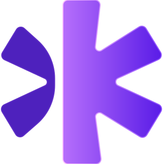

<p align="center">
  
</p>

# Kismet

An open-source AI agent for Unreal Engine. Kismet runs inside the editor and
edits Blueprints, Animation Blueprints, Materials and UMG widgets, then checks
its work with the compiler.

- Runs on your own model provider (Anthropic, OpenAI, Google, DeepSeek, Z.ai,
  Moonshot, MiniMax, OpenRouter, or local models through Ollama and LM Studio).
- No Kismet account is required.
- Includes a local MCP server, so external clients can use the same tools.
- Unreal Engine 5.6, 5.7, 5.8 and 5.9 on macOS (Apple Silicon) and Windows.

Website: <https://kismetai.io> · Docs: <https://kismetai.io/docs> · Discord: <https://discord.gg/tMaJbWHSEs>

## Install

Get a build for your engine version and platform from
<https://kismetai.io/download> or from [Releases](../../releases), and follow
[KismetAI/INSTALL.md](KismetAI/INSTALL.md).

Each release comes as ready-to-run binaries, and as the same build with full
source. Use the source variant if you compiled the engine yourself or package a
game with the plugin enabled.

## Build from source

The plugin is the [`KismetAI/`](KismetAI) folder. Copy or link it to
`<YourProject>/Plugins/KismetAI`, then build your project's Editor target:

```sh
git clone https://github.com/kismetai-io/Kismet.git
ln -s "$PWD/Kismet/KismetAI" /path/to/YourProject/Plugins/KismetAI
```

On Windows, copy the folder or use `mklink /D`. Build commands for each platform
are in [KismetAI/INSTALL.md](KismetAI/INSTALL.md).

## Repository layout

| Path | What it is |
| --- | --- |
| [`KismetAI/`](KismetAI) | The plugin: source, configuration and packaging script |
| [`CONTRIBUTING.md`](CONTRIBUTING.md) | Coding rules, building and running the tests |
| [`MAINTAINING.md`](MAINTAINING.md) | Supported versions, merge checks and cutting a release |
| [`SECURITY.md`](SECURITY.md) | How to report a vulnerability |

## License

The plugin is licensed under the [Apache License 2.0](LICENSE), from version
0.10.0. Third-party notices are in [KismetAI/NOTICE.md](KismetAI/NOTICE.md).

Releases tagged `v0.9.1` and earlier predate the open-source release. They are
binaries only and remain under the license included in each archive.

Unreal Engine is licensed separately by Epic Games. Kismet is independent and
is not sponsored or endorsed by Epic Games. The Kismet name and logo are not
licensed as trademarks by the Apache license.
